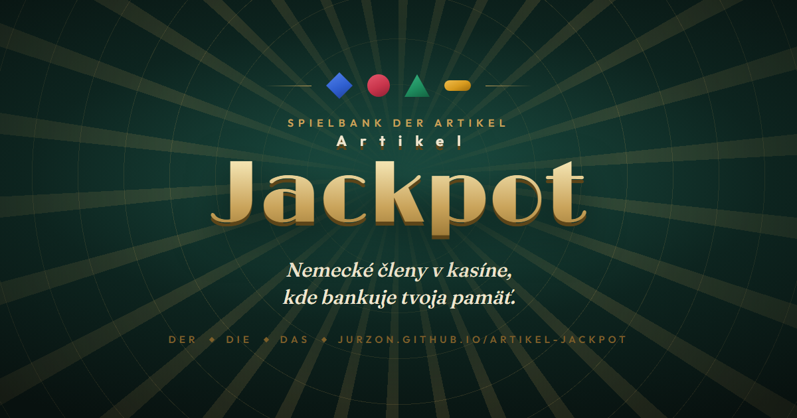
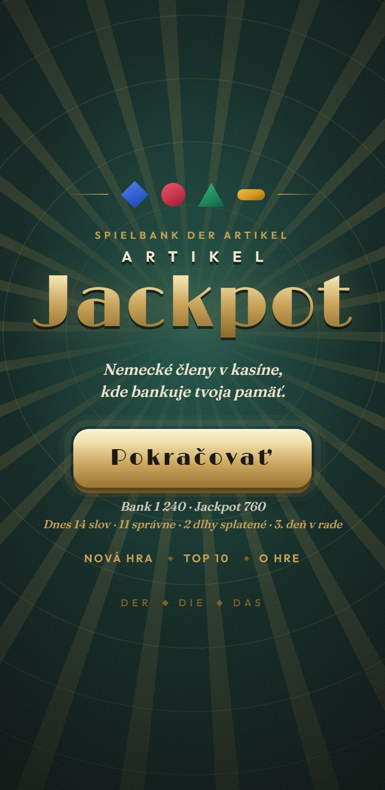
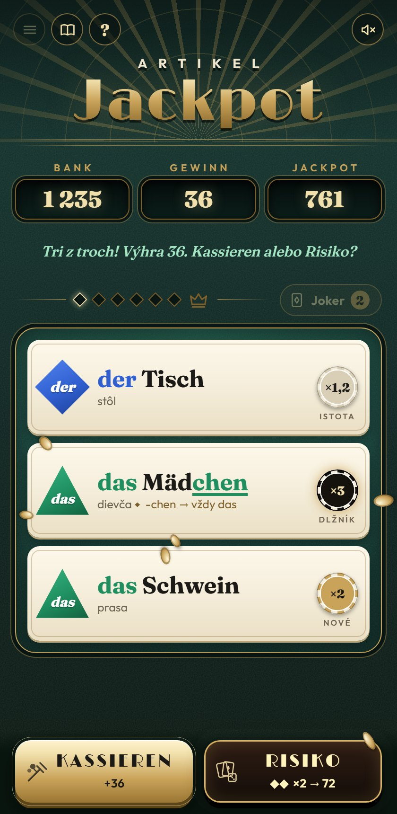
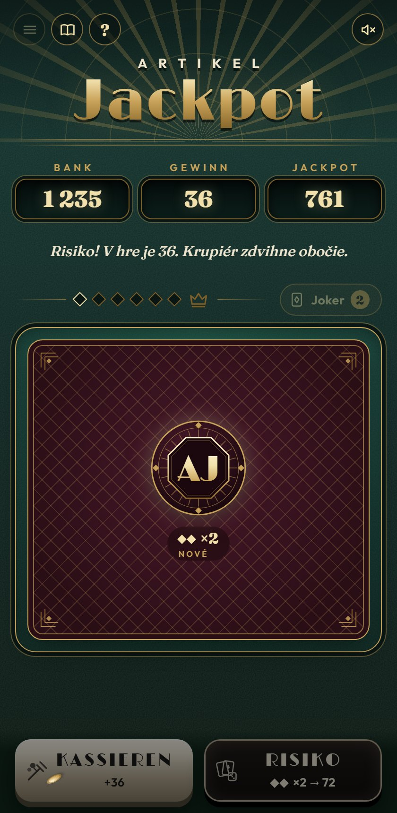
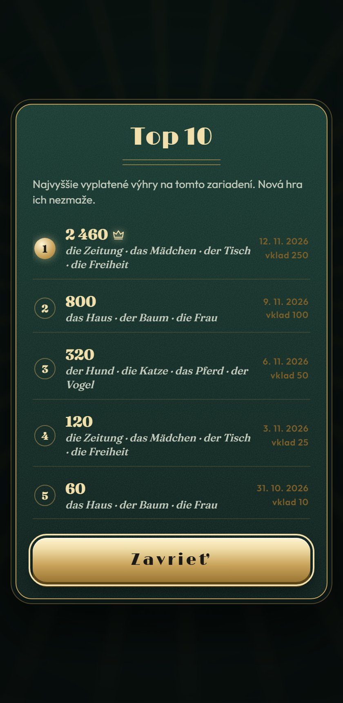

<p align="center">
  
</p>

<h1 align="center">Artikel Jackpot</h1>

<p align="center">
  Nemecké členy <b>der · die · das</b> ako kasínová hra, v ktorej bankuje tvoja pamäť.<br>
  Žiadne bifľovanie: vsádzaš, točíš, riskuješ. Čím horšie slovo poznáš, tým vyšší kurz.
</p>

<p align="center">
  <a href="https://jurzon.github.io/artikel-jackpot/"></a>
  <a href="https://github.com/jurzon/artikel-jackpot/actions/workflows/test.yml"></a>
  <a href="LICENSE"></a>
  
  
</p>

<p align="center">
  
  
  
  
</p>

## Zahraj si

Hra beží priamo v prehliadači, bez inštalácie, registrácie a reklám: **https://jurzon.github.io/artikel-jackpot/**

<p align="center">
  <br>
  <sub>Odfoť telefónom. Na mobile sa dá pridať na plochu ako aplikácia a funguje aj offline.</sub>
</p>

## Ako sa hrá

1. **Vsaď** žetóny a stlač **SPIN**. Padnú tri slová.
2. Pri každom vyber člen: **der**, **die**, **das**, alebo **—** (bez člena). Každá správna odpoveď násobí výhru **kurzom** slova. Jedna chyba a vklad je preč.
3. **Kurz určuje tvoja pamäť.** Slová, ktoré vieš, platia ×1,2 (istota). Nové ×2. Tie, čo si pokazil, ×3 (dlžník). Žetón pri slove ti to prezradí ešte pred odpoveďou.
4. **Drilling**: tri rovnaké členy v rade zdvojnásobia výhru.
5. Po línii: **Kassieren** (vziať výhru) alebo **Risiko**. Vidíš len kurz ďalšej karty, slovo až po rozhodnutí. Šesť priečok za sebou = **Jackpot**.
6. Za päť správnych v sérii dostaneš **Jokera**, ktorý vyškrtne dve zlé možnosti.
7. Bankrot? V **Pfandhause** si žetóny odpracuješ na vlastných chybách.

Klávesy: `1`–`4` člen · `medzerník` spin · `K` Kassieren · `R` Risiko · `J` Joker · `←` `→` vklad · `Esc` menu · `T` testovací mód.

## Čo učí a prečo to funguje

- **Leitnerova kartotéka v smokingu.** Každé slovo má svoj box (0–5). Správna odpoveď ho posúva vyššie, chyba ho zhodí na nulu a zapíše do **Knihy dlžníkov**. Kurz je len iný názov pre „ako dobre to vieš“.
- **Dlžníci sa vracajú.** Pokazené slová padajú na valce častejšie a s kurzom ×3, takže práve na nich sa dá najviac zarobiť aj naučiť.
- **Lekcia zadarmo.** Po prehre sa zvyšné karty aj tak otočia so správnym členom, prekladom a tipom. Každý spin naučí tri slová, nie jedno.
- **Pravidlo priamo v slove.** Keď člen vyplýva z koncovky alebo predpony (-ung, -chen, -keit, Ge-…), po odhalení sa tá časť podčiarkne farbou rodu: Zeit<u>ung</u>, Mäd<u>chen</u>.
- **Výslovnosť.** Odhalené slovo sa prečíta nahlas nemeckým hlasom systému (Web Speech API), aj s členom, ako jeden celok.
- **Denná zmena.** Lobby ukazuje, koľko slov si dnes prešiel, koľko dlhov splatil a koľký deň v rade hráš.
- **Vedený prvý spin.** Nováčika prevedú štyri bubliny, pravidlá sú vždy pod otáznikom.

Slovná zásoba: **386 položiek** – 327 podstatných mien (der 105, die 114, das 108), 27 krajín a miest (vrátane výnimiek ako *die Schweiz*, *der Iran*) a 32 fráz, v ktorých sa rozhoduje, či tam člen vôbec je (*Er arbeitet als Koch.*). Výber zodpovedá úrovniam A1–A2.

## Pre školy a učiteľov

- **Nasadenie = QR kód.** Na tabuľu, do zošita, do prezentácie. Žiadne účty, žiadne heslá, žiadna inštalácia.
- **Žiadne dáta neopúšťajú zariadenie.** Postup sa ukladá len v prehliadači žiaka. Hra nemá server, analytiku ani cookies tretích strán.
- **Funguje offline** po prvom načítaní, na mobile, tablete aj počítači, ovládateľná klávesnicou, rešpektuje nastavenie obmedzeného pohybu.
- **Bezplatne pre vzdelávanie** pod licenciou CC BY-NC-SA 4.0 (viď nižšie).
- Jednostranový popis pre vedenie školy, inštitúcie a vydavateľstvá: [docs/pitch.md](docs/pitch.md) · [docs/pitch-de.md](docs/pitch-de.md) (Deutsch).

## Spustenie lokálne

Je to statická stránka bez build kroku. Stačí akýkoľvek HTTP server:

```bash
git clone https://github.com/jurzon/artikel-jackpot.git
cd artikel-jackpot
python3 -m http.server 8080
# otvor http://localhost:8080/
```

Testy hernej logiky (Node 20+, bez závislostí):

```bash
node --test
```

## Štruktúra

| Súbor | Čo robí |
|---|---|
| `index.html` | Kabinet, lobby, dialógy (pravidlá, Kniha dlžníkov, Top 10, O hre, Pfandhaus), inline SVG ikony a ilustrácie |
| `style.css` | Vizuál „Spielbank 1926“: plsť, mosadz, krémový papier; animácie, responzívny layout |
| `js/engine.js` | Čistá herná logika bez DOM: kurzy, Leitnerove boxy, výber slov, výplaty, Top 10, denná zmena, pravidlá koncoviek |
| `js/ui.js` | Stavový automat hry, vykresľovanie, sprievodca, hlášky krupiéra |
| `js/words.js` | Slovná zásoba |
| `js/audio.js` | Zvuky syntetizované cez WebAudio a výslovnosť cez Web Speech API |
| `js/store.js` | Ukladanie postupu do `localStorage` |
| `sw.js`, `manifest.webmanifest` | Offline režim a inštalácia ako PWA |
| `test/engine.test.js` | Testy engine-u (`node --test`) |
| `docs/` | Pitch pre školy a partnerov, obrázky pre README |

## Pridanie slov

Slová sú v `js/words.js` v troch blokoch podľa člena, formát `Slovo:preklad` oddelený zvislou čiarou:

```js
der: `Tisch:stôl|Stuhl:stolička|…`,
```

Krajiny a mestá majú tvar `člen:Názov:preklad` (`-` = bez člena), frázy sú polia `[text s ___, člen, preklad, poznámka]`. Preklad nesmie obsahovať `:` ani `|`. Test `dáta: platné členy, preklady, žiadne duplicity` ustráži preklepy. Ak slovo spadá pod pravidlo koncovky, hra ho podčiarkne sama (`ruleMatch` v `js/engine.js`), výnimky ako *der Raum* alebo *das Zimmer* pravidlo nedostanú.

Testovací mód (`T` alebo `?test` v adrese) zvýrazní správnu odpoveď, hodí sa pri kontrole nových slov.

## Prispievanie

Projekt hľadá spoluhráčov: slová a mnemotechniky, grafiku a zvuk, ďalšie jazyky a režimy, testovanie v triedach. Ako na to, je v [CONTRIBUTING.md](CONTRIBUTING.md). Zmeny sú v [CHANGELOG.md](CHANGELOG.md).

## Licencia

Hra, jej texty a slovná zásoba sú pod licenciou [Creative Commons BY-NC-SA 4.0](LICENSE): môžeš ju voľne používať, zdieľať a upravovať na **nekomerčné** účely (škola, krúžok, samoštúdium), s uvedením autora a pod rovnakou licenciou. **Komerčné použitie** (vydavateľstvo, platená aplikácia, začlenenie do produktu) je možné po dohode: jurzon@seznam.cz.

Písma Fraunces, Limelight a Outfit sú pod [SIL Open Font License 1.1](fonts/OFL.txt).

## Autor

**Juraj Zonnenschein** · jurzon@seznam.cz

---

## English

**Artikel Jackpot** turns the hardest part of German for Slovak learners, the articles *der / die / das*, into a casino game where your own memory sets the odds. Three words fall on the reels; you pick the article for each. Words you know pay ×1.2, new words ×2, words you got wrong ×3, because that is where learning and winning overlap. A Leitner box system keeps track, lost hands still reveal every word, telling suffixes are underlined in the gender colour, and revealed words are pronounced by the system's German voice. 386 items at A1–A2 level with Slovak translations.

Static vanilla-JS PWA, works offline, no accounts, no tracking, nothing leaves the device. Play: https://jurzon.github.io/artikel-jackpot/ · Tests: `node --test` · License: CC BY-NC-SA 4.0, commercial licensing on request · Contact: Juraj Zonnenschein, jurzon@seznam.cz.

## Deutsch

**Artikel Jackpot** macht aus dem schwersten Kapitel des Deutschen für slowakische Lernende, den Artikeln *der / die / das*, ein Casinospiel, in dem das eigene Gedächtnis die Quote bestimmt. Drei Wörter fallen auf die Walzen, zu jedem wählt man den Artikel. Bekannte Wörter zahlen ×1,2, neue ×2, zuvor falsch beantwortete ×3, denn genau dort überschneiden sich Lernen und Gewinnen. Ein Leitner-System führt Buch, verlorene Runden decken trotzdem alle Wörter auf, regelhafte Endungen werden in der Genusfarbe unterstrichen, und aufgedeckte Wörter liest die deutsche Systemstimme vor. 386 Einträge auf Niveau A1–A2 mit slowakischen Übersetzungen.

Statische PWA ohne Framework, offlinefähig, keine Konten, kein Tracking, nichts verlässt das Gerät. Für Schulen kostenlos (CC BY-NC-SA 4.0), kommerzielle Lizenzen und Kooperationen auf Anfrage. Spielen: https://jurzon.github.io/artikel-jackpot/ · Kontakt: Juraj Zonnenschein, jurzon@seznam.cz · Kurzvorstellung für Schulen und Partner: [docs/pitch-de.md](docs/pitch-de.md).
